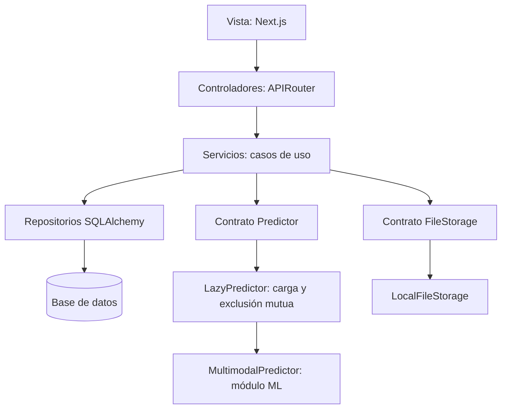
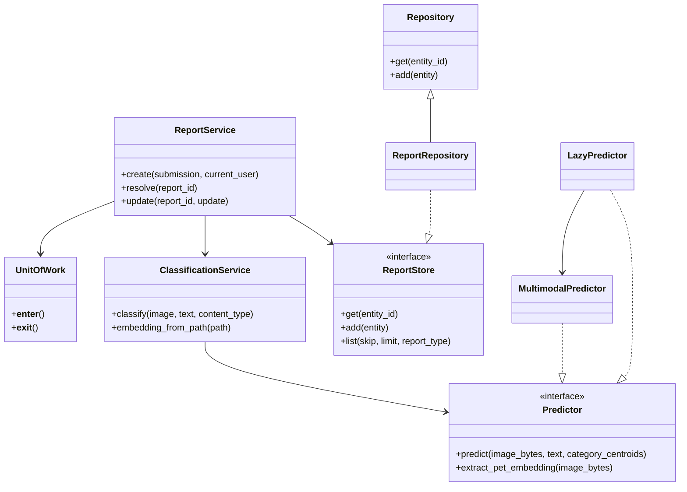
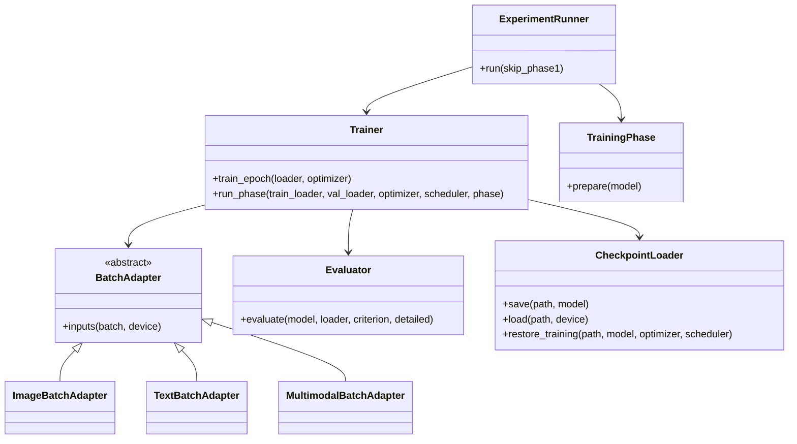

# Arquitectura de Bolívar Animal: MVC y POO

## Responsabilidades

La aplicación utiliza MVC con servicios y repositorios. Next.js implementa la vista; los controladores FastAPI traducen HTTP a llamadas de servicios; los servicios ejecutan casos de uso y reglas de negocio; los repositorios encapsulan SQLAlchemy. El modelo de dominio/persistencia y el modelo neuronal son conceptos diferentes.



`backend/app/main.py` configura la aplicación, los controladores, errores y ciclo de vida. No consulta tablas, crea usuarios ni reindexa imágenes. Las operaciones de mantenimiento se ejecutan por comandos explícitos.

## POO aplicada

| Principio | Implementación | Motivo |
|---|---|---|
| Encapsulamiento | `LocalFileStorage`, `CheckpointLoader`, `LazyPredictor` | Ocultar archivos, formato del checkpoint y carga de pesos detrás de operaciones explícitas |
| Abstracción | Protocolos `Predictor`, `FileStorage`, `ReportStore` | Expresar las capacidades que necesita un servicio sin exigir una implementación concreta |
| Polimorfismo | `BatchAdapter` y sus implementaciones | Usar el mismo `Trainer` para imagen, texto y multimodal |
| Composición | `ReportService`, `ExperimentRunner`, `BolivarMultimodalModel` | Construir un comportamiento mediante colaboradores inyectados |
| Herencia | `Repository[T]`, `BatchAdapter`, `nn.Module` | Compartir operaciones comunes y contratos cuando existe una relación de tipos |

Los protocolos permiten implementaciones estructurales: un predictor de prueba no necesita heredar de la implementación PyTorch. Las funciones matemáticas puras permanecen como funciones. Los controladores son funciones porque `APIRouter` ya proporciona la frontera HTTP.



## Backend

- `controllers/`: transporte HTTP, validación de entrada y autenticación mediante dependencias.
- `services/`: reportes, categorías, clasificación, matching, autenticación, feedback, REMUM y mantenimiento.
- `repositories/`: consultas, inserciones y actualizaciones SQL. `add()` hace `flush`, nunca `commit`.
- `infrastructure/`: almacenamiento, carga diferida de inferencia y unidad de trabajo.
- `core/`: configuración y errores de aplicación, traducidos centralmente a HTTP.
- `dependencies.py`: composición de servicios con una misma sesión por solicitud.
- `models.py`: entidades ORM y enumeraciones; se conserva el módulo para no romper migraciones/importaciones.
- `schemas.py`: contratos Pydantic centralizados.

### Crear un reporte

1. El controlador recibe `ReportSubmission` y el usuario opcional.
2. `ReportService` copia la entrada, obtiene o crea categoría y recupera el embedding cuando corresponde.
3. Actualiza el centroide de una categoría existente; una categoría nueva cuenta la muestra una sola vez.
4. Guarda reporte, predicción y feedback usando repositorios de la misma sesión.
5. `UnitOfWork` confirma todo junto. Cualquier fallo revierte todas las escrituras del caso de uso.

`ReportService`, `RemumService`, `AuthService`, `FeedbackService` y los comandos de `CategoryService` controlan transacciones. Los auxiliares de categoría usados dentro de la creación del reporte no abren ni confirman otra transacción.

Los errores de negocio no dependen de FastAPI: `NotFoundError`, `PermissionDeniedError`, `ApplicationError` y `ServiceUnavailableError` se traducen en 404, 403, 400 y 503.

### Matching

`ReportRepository` filtra candidatos en SQL. `MatchingPolicy` define tipos opuestos, puntuación y aceptación; `MatchingService` ordena los resultados. Los cálculos puros están en `services/similarity.py`. Los centroides se combinan mediante NumPy y la búsqueda neuronal contra centroides utiliza operaciones tensoriales.

Los bucles necesarios para candidatos, datos, épocas y lotes se mantienen. Se reemplaza duplicación y ramificación por composición, políticas y adaptadores; no se persigue eliminar palabras `if` o `for`.

### Cambios funcionales intencionales

- Se conserva una sola ruta de padrinos y requiere autenticación, como la primera definición anterior.
- REMUM valida permisos antes de cambiar estado o crear el reporte de extravío.
- Se conservan coordenadas `0` y confianza `0.0`.
- La fusión por nombre usa el ID real del destino; se rechaza fusionar una categoría consigo misma.
- Un fallo de predicción no deja una nueva imagen guardada.
- La creación de REMUM conserva latitud y longitud.

Las 24 rutas conservan parámetros, cuerpos y respuestas. El esquema de seguridad de padrinos cambia al eliminar la definición duplicada que sobrescribía OpenAPI.

## Machine Learning

- `models/`: encoders, fusión, modelo multimodal y baselines. Se conservan los nombres de parámetros para reutilizar pesos existentes.
- `preprocessing/`: imagen de evaluación/inferencia y tokenización comunes. Las aumentaciones se aplican solo a entrenamiento.
- `data/`: dataset multimodal, validación y balanceo por submuestreo de train.
- `training/engine.py`: `Trainer`, `TrainingPhase` y adaptadores de entradas.
- `training/experiment.py`: configuración, fases progresivas, grupos de parámetros del optimizador y evaluación final.
- `evaluation/`: `Evaluator`, métricas y matriz de confusión con etiquetas explícitas.
- `inference/`: predictor, checkpoints y sugerencias de categorías.
- `configs/`: configuración JSON de ViT, RoBERTa y multimodal.
- `cli.py`: entrada común de entrenamiento, evaluación, predicción y preparación de datos.

El módulo ML no importa FastAPI, SQLAlchemy ni módulos del backend. La taxonomía actual del código es de **6 clases**; `ml/taxonomy.py` sigue siendo la fuente de verdad.



### Checkpoints y entrenamiento

Los nuevos checkpoints guardan pesos, orden de etiquetas, configuración, versión del preprocesamiento, época, métricas y estados del optimizador/scheduler. La escritura utiliza un archivo temporal y reemplazo final. `restore_training()` restaura los estados guardados; no restaura estados aleatorios del proceso ni garantiza una continuación idéntica bit a bit.

Se pueden leer los `state_dict` anteriores. Cuando no hay metadatos y la dimensión coincide, las etiquetas se deducen de la taxonomía actual. Un artefacto histórico de otra dimensión exige proporcionar `legacy_labels` explícitas al cargador; no se inventan correspondencias. Entrenamiento incremental y evaluación rechazan órdenes incompatibles.

Los scripts `train_vit.py`, `train_roberta.py` y `train_multimodal.py` son entradas de compatibilidad que utilizan el mismo pipeline. Las utilidades históricas de recolección en `ml/datasets/` permanecen disponibles para no romper proveedores/rutas; no forman parte del flujo de ejecución de la aplicación. La preparación local nueva entra por `prepare-data`; no descarga imágenes ni fabrica muestras.

### Feedback y reentrenamiento

El backend exporta registros `image`, `text`, `label`, `feedback_id` y `report_id`. `IncrementalTrainer` consume estos datos sin abrir una base de datos. Mezcla correcciones válidas con muestras históricas de **train**, sin utilizar val/test como replay. Un dry-run no carga pesos, guarda checkpoints ni marca feedback.

El comando puente del backend marca únicamente los IDs procesados y solo después de guardar el checkpoint. No activa automáticamente los nuevos pesos: la evaluación y selección del artefacto siguen siendo una decisión explícita. Las categorías dinámicas fuera de `ml/taxonomy.py` requieren una actualización de taxonomía y cabeza neuronal antes de entrenarse.

## Comandos

Ejecutar desde la raíz con el entorno virtual activado:

```bash
source venv/bin/activate
pip install -r backend/requirements.txt -r ml/requirements.txt

# Base nueva o ya versionada
python backend/scripts/manage.py migrate
python backend/scripts/manage.py seed

# Base histórica creada sin Alembic: validar estructura y adoptar historial
python backend/scripts/manage.py migrate --adopt-existing

# Usuarios demo solo cuando se solicitan explícitamente
python backend/scripts/manage.py seed --demo-users

# La reindexación ya no ocurre al arrancar la API
python backend/scripts/manage.py reindex

python -m ml.cli train --model multimodal --dry-run
python -m ml.cli train --model multimodal --epochs-phase1 10
python -m ml.cli train --model vit
python -m ml.cli train --model roberta
python -m ml.cli evaluate --model multimodal --checkpoint ml/checkpoints/multimodal/best_multimodal_finetuned.pt
python -m ml.cli predict --image ruta/foto.jpg --text "Encontré un perro"
python -m ml.cli prepare-data --source ml/datasets/dataset.json

python backend/scripts/export_dataset.py --output /tmp/feedback.json
python backend/scripts/retrain.py --dry-run
python -m ml.cli incremental --feedback /tmp/feedback.json --dry-run

make test-python
```

`export_dataset.py` cambia deliberadamente el formato del archivo exportado para que sea consumible por el nuevo pipeline. El endpoint HTTP de exportación conserva su contrato anterior.

`./dev.sh` ejecuta migraciones y seed demo antes de los servidores. Ya no ejecuta `sync_db.py`, que copiaba y truncaba datos entre bases. Ese script histórico sigue disponible solo para uso manual consciente.

La migración `d6e9f03a2710` incorpora las columnas animales y tablas REMUM que antes se creaban fuera de Alembic. Es aditiva y admite esquemas históricos; su downgrade se rechaza porque no puede determinar qué columnas ya existían antes de adoptarlas. Para revertir esa reconciliación se necesita un backup previo.

## Verificación y límites

Las pruebas cubren contratos existentes, autenticación, matching, rollback de reporte/categoría/predicción/feedback, permisos antes de escrituras, coordenadas y confianza cero, ausencia de rutas duplicadas, inyección de un predictor de prueba y límites de importación.

ML se prueba con encoders pequeños inyectados en la arquitectura real, entrenamiento de un clasificador pequeño, guardado y recuperación de estados, adaptadores, métricas con clases ausentes y replay. No se afirma una nueva precisión del modelo: esta refactorización no reentrena ni modifica los checkpoints existentes.

Las migraciones se verifican sobre SQLite temporal, tanto desde cero como adoptando un esquema histórico con datos. La ejecución contra PostgreSQL requiere comprobarse en un entorno con ese servidor disponible.
