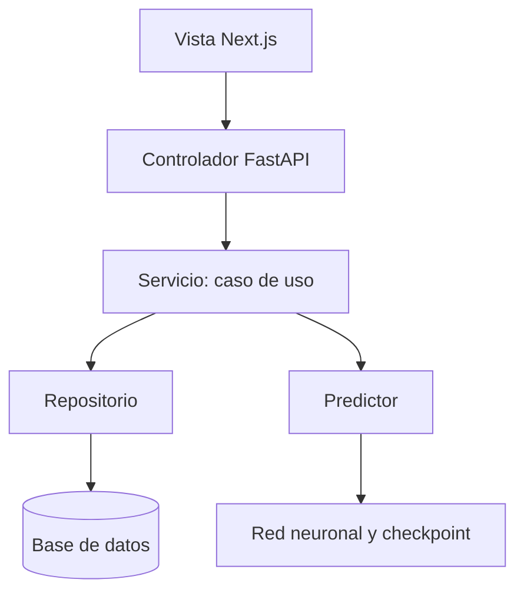
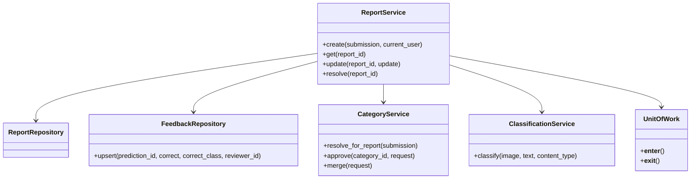

# Arquitectura de Bolívar Animal: MVC y POO

## Empezar por tres recorridos

Para entender el proyecto, seguir estos archivos en orden:

| Operación | Recorrido |
|---|---|
| Clasificar una foto | `controllers/reports.py:predict` → `ClassificationService.classify` → `LazyPredictor.predict` → `MultimodalPredictor.predict` |
| Crear un reporte | `controllers/reports.py:create_report` → `ReportService.create` → repositorios → `UnitOfWork` |
| Entrenar | `ml/cli.py` → `training/train.py:run_training` → `Trainer.fit` → `Trainer.train_epoch` |

La vista es Next.js. Los controladores reciben HTTP, los servicios aplican las reglas y los repositorios trabajan con SQLAlchemy. El modelo de aplicación (`Report`, `User`, `RemumRecord`) representa entidades; el modelo neuronal representa capas y operaciones sobre tensores.



## Qué hace cada carpeta

| Ubicación | Responsabilidad |
|---|---|
| `frontend/app/` y `frontend/components/` | Pantallas, formularios, filtros de presentación y estado de interacción |
| `frontend/lib/api.ts` | Llamadas HTTP al backend |
| `backend/app/controllers/` | Recibir solicitudes y devolver respuestas |
| `backend/app/services/` | Ejecutar casos de uso y decisiones de negocio |
| `backend/app/repositories/` | Consultar, insertar y actualizar entidades |
| `backend/app/models.py` | Entidades ORM y enumeraciones |
| `backend/app/schemas.py` | Contratos Pydantic de entrada y salida |
| `backend/app/auth.py` | Obtener el usuario autenticado para una solicitud |
| `backend/app/dependencies.py` | Construir servicios y obtener el predictor/almacenamiento compartidos |
| `backend/app/infrastructure/` | Archivos, transacciones, carga del modelo y funciones de contraseñas/JWT |
| `backend/app/core/` | Configuración y errores de aplicación |
| `backend/app/main.py` | Configuración HTTP, ciclo de vida y registro de controladores |
| `ml/models/` | Capas y método `forward()` de los modelos |
| `ml/data/` y `ml/preprocessing/` | Dataset, validación, imágenes y texto |
| `ml/training/` | Preparación, aprendizaje y entrenamiento incremental |
| `ml/evaluation/` | Métricas y matriz de confusión |
| `ml/inference/` | Predicción, sugerencias y checkpoints |
| `ml/configs/` y `ml/taxonomy.py` | Parámetros de entrenamiento y seis etiquetas activas |

## Ejemplo principal: crear un reporte

`ReportService.create()` muestra tres pasos:

1. Completar el embedding y pedir a `CategoryService.resolve_for_report()` la categoría definitiva.
2. Vincular el usuario y guardar un `Report` mediante `ReportRepository`.
3. Guardar la predicción y el feedback correspondiente mediante sus repositorios.

Los tres pasos están dentro de `with self.unit_of_work`. Los repositorios hacen `flush()` para obtener IDs, pero no confirman la operación. `UnitOfWork` confirma al finalizar y revierte las escrituras si algo falla. Una categoría nueva cuenta su primera muestra una sola vez.

`FeedbackRepository.upsert()` inserta o actualiza la devolución de una predicción. `FeedbackService` decide cuándo la devolución es válida y `ReportService` decide si hubo una corrección; el repositorio solo persiste los campos recibidos.

Los métodos públicos de reportes son `create`, `get`, `list`, `update`, `resolve` y `active_alerts`. Los detalles internos, como `_record_prediction()`, se mantienen dentro del servicio.

### Categorías y otras áreas

`CategoryService.approve()` y `merge()` son los casos de uso transaccionales de administración. `resolve_for_report()`, `create_or_get()` y `update_centroid()` participan de la transacción del reporte; no hacen una confirmación independiente.

`MatchingService` consulta candidatos mediante `ReportRepository` y los puntúa con `MatchingPolicy`. Los cálculos puros están en `services/similarity.py`.

`RemumService` registra mascotas, salud, padrinos y alertas. Los permisos de una alerta se comprueban antes de escribir. Las imágenes se eliminan si falla el registro que las iba a utilizar.

`AuthService` realiza registro y login. Las funciones de hashing y JWT están en `infrastructure/security.py`; `auth.py` resuelve la autenticación de una solicitud HTTP.

## Dónde está la POO

| Principio | Ejemplo real | Qué permite |
|---|---|---|
| Encapsulamiento | `Trainer`, `LocalFileStorage`, `CheckpointLoader` | Reunir estado y operaciones relacionadas |
| Composición | `ReportService` recibe repositorios, clasificación y una unidad de trabajo | Combinar colaboradores con funciones claras |
| Abstracción | Contratos `Predictor` y `FileStorage` | Definir capacidades sin exigir una implementación particular |
| Polimorfismo | ViT, RoBERTa y multimodal aceptan entradas por nombre | Utilizar el mismo `Trainer` con los tres modelos |
| Herencia | Los modelos heredan de `nn.Module`; los repositorios especializados de `Repository` | Reutilizar una base con una relación de tipos concreta |

Los controladores pueden ser funciones `APIRouter`. Los cálculos matemáticos pueden ser funciones puras. La POO se aplica a responsabilidades con estado o comportamiento relacionado.



## Comunicación con la red neuronal

`get_predictor()` en `dependencies.py` es el punto de construcción compartido por la API y los comandos del backend. Conserva una instancia por proceso. Esa instancia es `LazyPredictor`, que administra la carga y coordina el acceso al modelo mediante un bloqueo.

El arranque HTTP inicializa ese proveedor. También puede inicializarse al primer uso desde un comando. Importar la API no carga PyTorch ni pesos. El ciclo de vida respeta un proveedor de prueba inyectado mediante `dependency_overrides`.

`ClassificationService` consulta centroides, pide la predicción y guarda la imagen si la predicción fue exitosa. `MultimodalPredictor`, dentro de ML, prepara imagen/texto, ejecuta la red con `eval()` y `no_grad()` y devuelve sus resultados. La comunicación ocurre mediante llamadas Python dentro del proceso del backend.

ML no importa FastAPI, SQLAlchemy ni módulos del backend. La exportación de feedback es el puente de datos hacia entrenamiento.

## Entrenamiento sencillo

```text
Configuración JSON → train.py → Trainer.fit() → Trainer.train_epoch()
                                    ↓
                         Evaluación y checkpoint
```

Leer primero `run_training()`: preparar datos/modelo, entrenar fases y medir sobre test. Después leer `Trainer.fit()` y `train_epoch()`. La [guía corta de entrenamiento](../ml/training/README.md) explica épocas, lotes y fases.

Los baselines aceptan las entradas que utilizan e ignoran las adicionales mediante `**kwargs`. El multimodal consume imagen y texto. El entrenador llama a `model(**inputs)` y comparte el mismo ciclo de aprendizaje.

Los checkpoints guardan pesos, etiquetas, configuración, época, métricas y estados de optimizador/scheduler. Se escriben en un archivo temporal y se reemplaza el destino al terminar. `restore_training()` recupera los estados guardados; no garantiza continuación idéntica bit a bit porque no restaura el estado aleatorio completo.

Los `state_dict` históricos se pueden cargar cuando coinciden con la taxonomía actual. Una dimensión diferente exige `legacy_labels` explícitas. Evaluación e incremental rechazan órdenes incompatibles.

El incremental mezcla correcciones válidas con ejemplos históricos de train, manteniendo val/test fuera del replay. El comando del backend marca feedback procesado solo después de guardar el checkpoint. Entrenar no activa automáticamente el artefacto nuevo.

## Guía de comandos activos

Desde la raíz, con el entorno virtual activado:

```bash
source venv/bin/activate
pip install -r backend/requirements.txt -r ml/requirements.txt

# Desarrollo: migración, seed demo y servidores
./dev.sh

# Mantenimiento independiente
python backend/scripts/manage.py migrate
python backend/scripts/manage.py seed
python backend/scripts/manage.py seed --demo-users
python backend/scripts/manage.py reindex

# Adoptar una base histórica sin historial Alembic
python backend/scripts/manage.py migrate --adopt-existing

# Entrenamiento y evaluación
python -m ml.cli train --model multimodal --dry-run
python -m ml.cli train --model multimodal
python -m ml.cli train --model vit
python -m ml.cli train --model roberta
python -m ml.cli evaluate --model multimodal --checkpoint ml/checkpoints/multimodal/best_multimodal_finetuned.pt
python -m ml.cli predict --image ruta/foto.jpg --text "Encontré un perro"
python -m ml.cli prepare-data --source ml/datasets/dataset.json

# Feedback exportado y entrenamiento incremental
python backend/scripts/export_dataset.py --output /tmp/feedback.json
python backend/scripts/retrain.py --dry-run
python -m ml.cli incremental --feedback /tmp/feedback.json --dry-run

make test-python
```

La API mantiene su contrato de exportación HTTP; el comando de exportación genera los campos `image`, `text`, `label`, `feedback_id` y `report_id` para ML.

La migración de reconciliación `d6e9f03a2710` es aditiva y su downgrade exige restaurar un backup, porque admite columnas que ya existían antes de adoptarlas. En esta implementación no se ejecutaron migraciones sobre datos del usuario.

## Inventario de utilidades históricas

| Archivo o grupo | Estado y motivo |
|---|---|
| `backend/app/crud.py`, `ai_service.py`, `llm_categorizer.py` | Retirados tras migrar scripts y pruebas a servicios, repositorios y ML |
| `backend/scripts/seed.py` | Conservado para escenarios demo con imágenes y descargas; usa las dependencias actuales |
| `backend/scripts/seed_centroids.py` | Conservado como herramienta manual de centroides, incluido su modo determinista de prueba |
| `backend/scripts/update_coords.py` | Conservado para mantenimiento puntual de coordenadas |
| `backend/scripts/sync_db.py` | Conservado para transferencia manual histórica; no forma parte de `dev.sh` ni del arranque |
| `ml/datasets/collect_*`, `complete_*` y otras utilidades de recolección | Conservadas por sus tareas específicas; fuera del runtime y del entrenamiento principal |
| `ml/datasets/multimodal_dataset.py` | Retirado al no tener consumidores; la implementación única del dataset está en `ml/data/dataset.py` |

## Verificación

Los resultados de la ejecución del plan están en [VERIFICACION_MVC_POO.md](VERIFICACION_MVC_POO.md). Las pruebas cubren reglas, transacciones, límites arquitectónicos, entrenamiento pequeño y checkpoints. Una prueba de inferencia real no implica reentrenar ni medir una nueva precisión del modelo.
